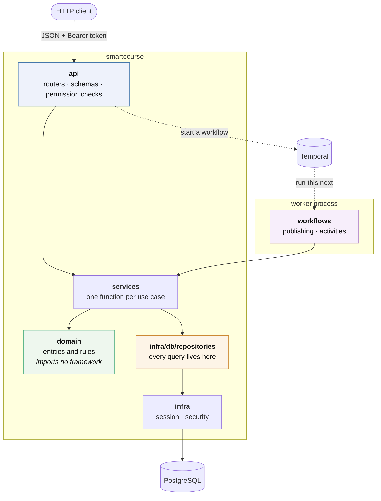

# SmartCourse

Backend for EduCorp's intelligent course delivery platform — a distributed,
event-driven learning system with a GenAI assistant layer.

An eMumba upskilling assignment, September–October 2026.

---

## What it is

EduCorp runs an online learning platform built for far fewer users than it now
has. Publishing a course is slow and manual, course data and analytics
disagree with each other, and busy periods back up enrollments and
notifications.

SmartCourse is a replacement backend. Instructors author courses; students
enrol and work through them; and the slow parts — content processing,
analytics, notifications — happen in the background, reliably, without
blocking anyone.

The full problem statement, use cases, requirements and the assumptions
filling gaps the brief leaves open are in **[docs/PRD.md](docs/PRD.md)**.

---

## Architecture

Four layers. **Imports point inward only.**



**Two processes, not one.** The API never runs workflow code — it starts a
workflow and returns. A separate worker asks Temporal what to do next and
runs it. They scale and fail differently: publishing a 200-lesson course
should not compete for the event loop serving logins, and a worker crash
should not take the API with it.

Notice both arrows into `services`. The use cases are called by HTTP
requests *and* by workflow activities, which is the whole reason they know
nothing about either.

**Why the direction matters.** `domain` depends on nothing, so business rules
can be tested without a database or a web server. `services` hold the use
cases and know nothing about HTTP — which is what will let the Temporal
workflows and Celery workers of later modules call exactly the same code,
with no request and no status code to return.

**Three things are separated deliberately:**

| Question | Answered in |
|---|---|
| *Are you an instructor at all?* | `api` — `require_roles` on the route |
| *Is this **your** course?* | `services` — a rule that must hold for callers with no route |
| *How do I fetch that?* | `repositories` — the only place queries are built |

Design decisions, including the options rejected, are in
**[docs/SCHEMA.md](docs/SCHEMA.md)** and **[docs/API.md](docs/API.md)**.

---

## Getting started

**Prerequisites:** [Docker Desktop](https://www.docker.com/products/docker-desktop/)
and [uv](https://docs.astral.sh/uv/).

Everything in one command:

```bash
git clone git@github.com:faraz-jahangir-emumba/smartcourse-backend.git
cd smartcourse-backend
cp .env.example .env
docker compose up -d --build
```

That starts Postgres, Temporal, applies the migrations and runs the API.
Open **<http://localhost:8000/docs>** or **<http://localhost:8000/redoc>**.

`--build` matters after you change code: without it Compose reuses the image
it already has, so your edit is not in the container.

**To publish a course you also need the worker**, in its own terminal:

```bash
uv run python -m smartcourse.worker
```

Nothing in the API runs workflow code. Without a worker a publish is
accepted and then waits — it does not fail, and it resumes the moment a
worker appears.

### Working on the code

The container has no `--reload`, so for development run the app yourself and
keep only the servers in Docker:

```bash
docker compose up -d postgres temporal
uv sync
uv run alembic upgrade head
uv run uvicorn smartcourse.main:create_app --factory --reload
uv run python -m smartcourse.worker       # second terminal, if publishing
```

### An admin account

`admin` cannot be self-assigned and no endpoint grants it, so the first one
is created by a seed command. Set both variables in `.env` and the seed
service creates the account on `docker compose up`:

```
ADMIN_EMAIL=you@example.com
ADMIN_PASSWORD=something-long
```

Check it worked with `docker compose logs seed`. With the variables unset it
prints a line and does nothing, so a fresh clone still comes up clean.

> **On a network that intercepts TLS**, `uv` fails with
> `invalid peer certificate: UnknownIssuer`. Set `UV_SYSTEM_CERTS=1` so it
> trusts the operating system's certificate store instead of its own.

---

## API

Everything sits under `/api/v1`. The interactive documentation at **`/docs`**
is generated from the code, so it cannot go stale — including which fields are
required and what each one validates. Click **Schema** rather than **Example
Value** to see required fields marked.

### Authentication and accounts

| | | Who |
|---|---|---|
| `POST` | `/auth/register` | anyone |
| `POST` | `/auth/login` | anyone |
| `GET` | `/users/me` | any signed-in user |
| `PATCH` | `/users/me` | any signed-in user |

`/auth` is for proving who you are. `/users/me` is the account itself — a
thing you read and change — so it lives under its own prefix.

Login returns a bearer token lasting one hour, sent back as
`Authorization: Bearer <token>`, together with the user it belongs to. The
user is already loaded to check the password, so returning it saves every
client an immediate second call.

The token carries a user id and nothing else. Roles are read from the
database on every request, which costs one query and buys two things: a role
change takes effect on the next call rather than when the token expires, and
a deactivated account stops working immediately instead of staying valid for
up to an hour.

Registration accepts `student` and `instructor`. **Admin cannot be
self-assigned** — a public endpoint where the caller picks their own role
would let anyone become an admin by editing one field. The same rule applies
to `PATCH /users/me`, or the hole would simply move: register as a student,
then promote yourself.

`PATCH /users/me` changes your name or your roles. Adding `student` to an
instructor account is UC-07 — an instructor who wants to learn keeps one
account rather than opening a second.

**Email cannot be changed**, and sending one returns `422` rather than being
quietly ignored, so a caller is never told a change worked when it did not.
Email is the login identifier: changing it changes who you are to the system.
The consequence is that a mistyped address cannot be repaired by anyone —
there is no admin user endpoint either. That is a known gap, not an oversight.

Password changes have no endpoint yet. Changing one has to prove you know the
current password, or anybody holding a stolen token could lock the real owner
out permanently — which is its own input, its own rules and its own tests.

### Courses, modules and lessons

| | | Who |
|---|---|---|
| `POST` | `/courses` | instructor |
| `GET` | `/courses` | any signed-in user |
| `GET` | `/courses/{id}` | any signed-in user |
| `PATCH` | `/courses/{id}` | the owning instructor |
| `DELETE` | `/courses/{id}` | the owning instructor |
| `POST` | `/courses/{id}/modules` | the owning instructor |
| `GET` | `/modules/{id}` | any signed-in user |
| `PATCH` | `/modules/{id}` | the owning instructor |
| `DELETE` | `/modules/{id}` | the owning instructor |
| `POST` | `/modules/{id}/lessons` | the owning instructor |
| `GET` | `/courses/{id}/lessons` | any signed-in user |
| `GET` | `/lessons/{id}` | any signed-in user |
| `PATCH` | `/lessons/{id}` | the owning instructor |
| `DELETE` | `/lessons/{id}` | the owning instructor |
| `POST` | `/courses/{id}/publish` | the owning instructor, or an admin |

**A published course can still be edited.** Until Module 2 it could not, and
there was no way back from `ready` — so a published course could never be
corrected again, not even a typo. It stays `ready` while being edited:
students read lesson content directly and see the fix at once. What goes
stale is the chunk index behind the assistant, which republishing refreshes.

The one closed state is `publishing`. The workflow is reading the content
while it runs, and an edit underneath it would leave some chunks built from
the old text and some from the new.

**Prerequisites** are set on the course, as the complete list:

```
PATCH /courses/{id}
{ "prerequisite_ids": ["<course-id>", "..."] }
```

The whole set every time, like `module_order`. "Add one" would need a
matching "remove one", and then the two can disagree about what the set
currently is. An empty list clears them; omitting the field leaves them
alone.

Three refusals, all `422`: a course that does not exist, a course requiring
itself, and two courses requiring each other. That last one matters because a
loop makes both courses permanently unenrollable *silently* — nothing errors,
students simply can never get in.

Longer chains — A needs B, B needs C, C needs A — are **not** caught. That is
FR-08a, which needs a recursive walk of the whole graph and is deferred. A
two-course loop is an accident; a three-course loop takes determination.

### Enrollment

| | | Who |
|---|---|---|
| `POST` | `/courses/{id}/enrollments/enroll` | any student |
| `POST` | `/courses/{id}/enrollments/withdraw` | the enrolled student |
| `GET` | `/courses/{id}/enrollments` | the owning instructor, or an admin |
| `GET` | `/users/me/enrollments` | any signed-in user |

Two verbs among all the nouns, deliberately. Enrolling and withdrawing are
named state transitions with rules that can refuse them; a roster is a
collection. A verb earns its place only when a transition has a name and
rules — `PATCH {"status": "withdrawn"}` would let a student mark themselves
`completed` without finishing a lesson.

Neither endpoint takes a body. Which course is in the path, who you are is in
the token, and a body would be a third place to say the same thing.

**Four rules decide whether you may join**, in this order:

| | |
|---|---|
| The course is published | otherwise 404 — a 403 would confirm a draft exists |
| You hold the `student` role | 403. UC-07: an instructor who wants to learn adds the role |
| You are not already enrolled | 409. FR-06 |
| Prerequisites are *completed* | 409, naming what is missing. Being part way through does not count |
| A seat is free | 409. FR-07 |

Cheapest first, and the capacity check last on purpose — it is the only one
that takes a database lock, and the lock is held until the request commits.

**Withdrawing does not delete anything.** The row stays and its status
changes, because FR-10 requires history and `lesson_progress` cascades from
enrollments. `GET /users/me/enrollments` returns every status, including the
courses you left. Re-enrolling later creates a new row with fresh progress —
which is why `uq_enrollments_one_active` is a *partial* unique index: one
active enrollment, unlimited history.

**Capacity is nullable, and null is not zero.** Null means unlimited, and an
unlimited course takes no lock at all.

### Publishing

```
POST /courses/{id}/publish     →  202 Accepted, immediately
```

Publishing is not a status change. Part A §2 describes a multi-step
background process, and FR-13 requires that a failure never leaves a course
half-published — so it runs as a **Temporal workflow**, which is why the
worker exists.

```
draft  ──▶  publishing  ──▶  ready
                        └─▶  failed
```

The request returns in milliseconds, before any work is done:

```json
{
  "course_id": "e11a8634-…",
  "workflow_id": "publish-course-e11a8634-…",
  "status_url": "/api/v1/courses/e11a8634-…"
}
```

Poll `status_url` and watch `status` change. `workflow_id` is the handle for
this publish in Temporal's UI at **<http://localhost:8233>**, which is where
to look when one is stuck.

**What it does.** One activity per lesson: split the content into chunks,
write them, and only mark the course `ready` once every lesson is done. A
failure retries that lesson three times, then marks the course `failed` —
never leaving it on `publishing`, which is the one state nobody can diagnose
by looking at it, because it means either "still working" or "the worker
died an hour ago".

**You cannot publish the same course twice at once.** The workflow id is
`publish-course-{id}`, and Temporal refuses a second workflow with an id
already running. Not "unlikely to" — the second request gets a 409.

**Republishing is cheap.** Each chunk stores a hash of its text, so a
republish only rewrites what actually changed. Editing one lesson does not
re-process the other 199 — which matters in Module 4, where every chunk
carries an embedding that costs time and money to produce.

### Search

```
GET /courses?q=python
GET /courses/{id}/lessons?q=recursion
```

Postgres full-text search, not `LIKE`. Words are stored stemmed, so
**searching "recursive" finds a course describing "recursion"** — which is
the point, since the word somebody half-remembers is rarely the word the
author used.

Titles outrank bodies. A course *called* "Python Basics" comes above one
whose description mentions python in passing, because title and body words
are stored in different weight bands.

**Search obeys the same visibility rules as browsing.** It is one more
condition on the same query, not a separate path — so a student searching
cannot surface a draft they could not otherwise see.

Lesson search is scoped to one course, which is the question a student
actually has. Without `q`, that endpoint just lists the course's lessons in
reading order.

### Three things worth knowing before using it

**Who can see what.** FR-05 promises students browse *published* courses, and
a draft is unfinished by definition.

| | student | instructor, own | instructor, others' | admin |
|---|---|---|---|---|
| `draft` · `publishing` · `failed` | ✗ | ✓ | ✗ | ✓ |
| `ready` | ✓ | ✓ | ✓ | ✓ |

Enforced on every read, including single modules and lessons — filtering a
list achieves nothing if an id still works. A course you may not see returns
**404, not 403**: a 403 would confirm it exists.

**Reads are generous, writes are narrow.** `GET /courses/{id}` returns the
whole course nested, because reading cannot corrupt anything. Changing things
takes one call per thing changed.

**Ordering is set on the parent, as a complete list of ids:**

```json
PATCH /courses/{id}
{ "module_order": ["<module-b>", "<module-a>"] }
```

Never "move this one to position 2" — that is ambiguous between swapping two
items and shifting a run of them, and the two give different results. A
partial list is rejected rather than leaving the rest at stale positions.

### Errors

One shape for every failure, so a client handles them once:

```json
{ "error": { "code": "conflict", "message": "That email is already registered." } }
```

| | |
|---|---|
| `401` | no token, or an invalid one |
| `403` | signed in, but not allowed |
| `404` | no such thing — or nothing you may see |
| `409` | conflicts with the current state |
| `422` | failed validation |

---

## Development

```bash
uv run pytest                                     # the test suite
uv run pytest -v                                  # with test names
uv run alembic revision --autogenerate -m "..."   # a new migration
uv run alembic upgrade head                       # apply migrations
docker compose down                               # stop, keep data
docker compose down -v                            # stop and delete data
```

**144 tests.** They need Postgres; the six workflow tests also need
Temporal and skip with a message if it is not running. CI starts both, and
there the skip is turned into a failure — a skipped test in CI looks
exactly like a passing one, which would leave the compensation unproven
while the build stayed green.

Isolation works at two levels: a throwaway `smartcourse_test` database is
created, migrated from empty and dropped per run — which is also the only
thing that checks the migrations work on a fresh clone — and within it each
test runs in a transaction that is rolled back.

Some tests deliberately step outside that. Anything about a race —
two students taking the last seat, two modules added at once — opens real
sessions and commits for real, because two "concurrent" requests sharing
one rolled-back transaction would see each other's uncommitted work and no
race could happen.

**Always read a generated migration before applying it.** Alembic does not
compare CHECK constraint expressions, nor whether a constraint is
deferrable, so changing either produces an *empty* migration that silently
claims success. Both have happened here; both were written by hand.

---

## Project layout

```
src/smartcourse/
├─ api/                 HTTP
│  ├─ routers/          one module per area
│  ├─ schemas/          what crosses the wire, kept apart from the models
│  ├─ deps.py           get_current_user · require_roles · repositories
│  └─ errors.py         the only place that knows ConflictError means 409
├─ domain/              entities and rules; imports no framework
├─ services/            use cases
├─ workflows/           Temporal
│  ├─ publishing.py     orchestration only; must be deterministic
│  └─ activities.py     the work; anything is allowed here
├─ infra/
│  ├─ db/
│  │  ├─ models/        SQLAlchemy models
│  │  ├─ repositories/  every query
│  │  ├─ migrations/    alembic
│  │  └─ session.py     engine and per-request session
│  ├─ security.py       password hashing, token signing
│  └─ temporal.py       the workflow client
├─ seed.py              creates the first admin
├─ worker.py            runs workflow code; its own process
└─ main.py              the application factory

docs/                   PRD · schema · API design
tests/                  pytest suite
```

**The split inside `workflows/` is the one that matters.** A workflow is
re-run from the top whenever Temporal rebuilds its state, so it must take
the same path every time — no clock, no randomness, no database. Anything
unpredictable goes in an activity, whose result is recorded once and
replayed afterwards. Workflows decide; activities do.

Neither contains rules. Both call `services/`, the same functions the HTTP
endpoints call.

---

## Tech stack

**Backend** — Python 3.12, FastAPI, PostgreSQL, SQLAlchemy 2.0 (async),
Alembic, Argon2, JWT
**Workflows** — Temporal
**Tooling** — uv, pytest, Docker Compose, GitHub Actions

Postgres is doing more than storing rows, and that is deliberate: full-text
search, a partial unique index enforcing one active enrollment per course
while keeping history, deferred constraints so positions can be reshuffled
inside a transaction, and `SELECT … FOR UPDATE` where a check-then-write
would otherwise race. Each is a rule the database holds rather than one the
application hopes to remember.

Arriving in later modules, per the brief: MongoDB, Redis, Celery with
RabbitMQ, Kafka with Schema Registry, OpenTelemetry with Prometheus, Grafana
and Jaeger, then LangGraph and a vector store.

---

## Progress

| Module | | |
|---|---|---|
| **1** | Foundation and core services | **complete** |
| **2** | Enrollment and publishing workflow | **complete** |
| 3 | Event-driven system and observability | not started |
| 4 | Retrieval layer | not started |
| 5 | AI assistant and streaming | not started |

**Module 1 delivered:** service structure defined, database schema created
(10 tables), basic APIs working, local setup ready — plus a test suite,
which the brief names in its evaluation criteria but no module budgets time
for. Reviewed on 16 October; the seven improvements it raised are fixed, and
the two it left open are answered in `STATE.md`.

**Module 2 delivered:** enrollment with duplicate handling, capacity,
prerequisites and history; publishing as a Temporal workflow with
compensation; and full-text search, which `SCHEMA.md` had described for six
weeks without it existing.

**Known gaps, deliberately.** Instructors self-register with no approval
step — Part A asks for registration with roles and nothing more, and the
flow it would need has no endpoints yet. Nobody can change an email, not
even an admin. Analytics, events and notifications are Module 3; Part A §3
lists two of the four things that happen on enrollment as happening there,
so that flow is half-built by the brief's own description.

Everything above, with the reasoning and the options rejected, is in
`STATE.md`.

---

## Documentation

- **[docs/PRD.md](docs/PRD.md)** — problem, use cases, numbered requirements,
  traceability, and the assumptions filling gaps the brief leaves open
- **[docs/SCHEMA.md](docs/SCHEMA.md)** — every table and column with the
  reasoning, including the options rejected
- **[docs/API.md](docs/API.md)** — endpoint design and the rules behind it
