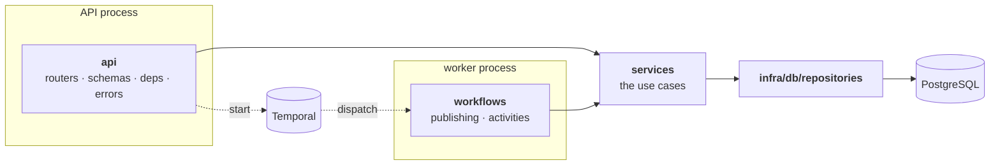
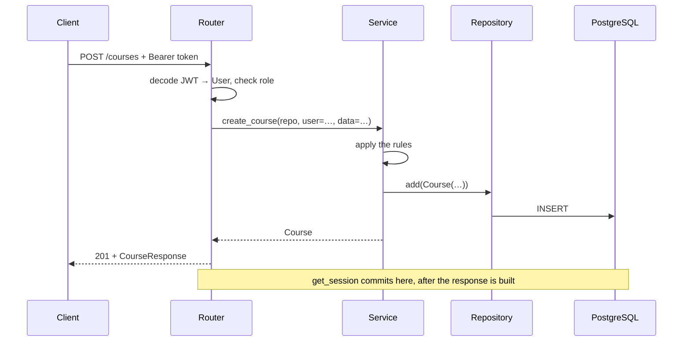
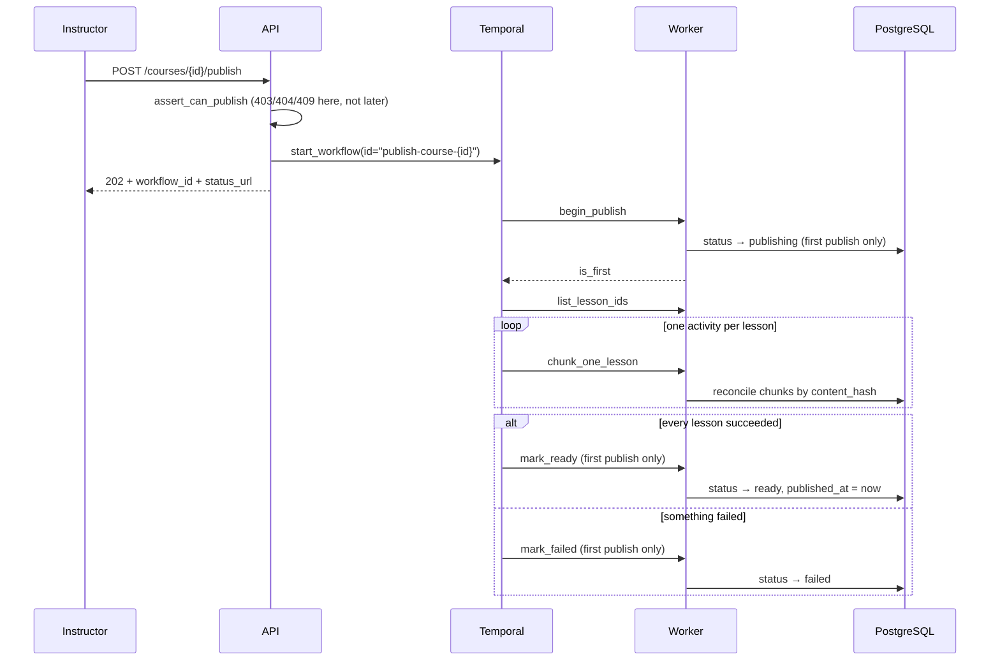

# SmartCourse — Technical Design

How the system is put together, how data and events move through it, and
which decisions were deliberate.

The README is the tour: what it is, how to run it, what the endpoints are.
This is the argument underneath — why the pieces are shaped this way and
what was rejected. Where a decision has a cost, the cost is stated.

Companions: **[SCHEMA.md](SCHEMA.md)** for every table and column,
**[API.md](API.md)** for endpoint design, **[PRD.md](PRD.md)** for the
numbered requirements referenced throughout (FR-nn).

---

## 1. Module breakdown

Two processes run. They share a codebase and a database and nothing else.



### `api/` — HTTP, and nothing else

| File | Holds |
|---|---|
| `routers/` | `auth`, `users`, `courses`, `enrollment` — paths, status codes, response shapes |
| `schemas/` | Pydantic request and response models |
| `deps.py` | Dependency wiring: the session, the current user, repositories, the Temporal client, `require_roles` |
| `errors.py` | One exception handler per domain error, so a service raising `ConflictError` becomes a 409 without knowing what a 409 is |

Routers answer exactly one permission question: **are you this kind of user
at all?** `dependencies=[InstructorOnly]` on the route. Anything requiring
knowledge of the row — *is this your course* — belongs a layer down.

That split was not free. Publishing originally skipped the route-level half,
so a student fell through to the ownership check and was told the course did
not exist — about a course they could read in the catalogue. The fix was to
apply the same two-part pattern as everything else.

### `services/` — one function per use case

The layer that would survive replacing FastAPI. No request object, no status
codes, no `temporalio` import.

| Module | Use cases |
|---|---|
| `auth.py` | register, authenticate, update profile, role self-assignment rules |
| `course.py` | the course/module/lesson tree, visibility, editability, content gating |
| `enrollment.py` | enrol, withdraw, listings, prerequisites, capacity |
| `publishing.py` | publish permissions, status lifecycle, incremental chunking |
| `chunking.py` | pure text splitting — no database, no awaits |

**Both processes call this layer.** An HTTP request reaches `services` through
a router; a Temporal activity reaches the *same functions* directly. That is
the entire reason they know nothing about either, and it is what makes
publishing testable without a worker running.

### `domain/` — thin, deliberately

Only `errors.py`: `NotFoundError`, `PermissionDeniedError`, `ConflictError`,
`ValidationError`. The base class every layer can raise and only `api/`
knows how to translate.

**It is thinner than the layering implies**, and that is a tradeoff rather
than an oversight — see §4.

### `infra/` — everything that talks to the outside

| File | Holds |
|---|---|
| `db/models/` | SQLAlchemy models — the tables |
| `db/repositories/` | **Every query in the system.** `user`, `course`, `enrollment`, `chunk` |
| `db/session.py` | Engine, `SessionFactory`, and the request-scoped `get_session` |
| `security.py` | Argon2 hashing, JWT encode/decode |
| `temporal.py` | The lazily-connected, cached Temporal client |

If a `select()` appears outside `repositories/`, that is a bug. The point is
not purity: it is that when a query is slow, or a filter is wrong, there is
one place to look.

### `workflows/` — orchestration, and the work

| File | Holds |
|---|---|
| `publishing.py` | `PublishCourseWorkflow` — *what happens in what order*. No database access, no clock, no randomness |
| `activities.py` | Five activities, each a thin wrapper: open a session, call `services/publishing.py`, commit |

The division is forced by Temporal. A workflow is replayed from its recorded
history to rebuild its state, so it must take the same path every time.
Anything unpredictable — I/O, time, random — belongs in an activity, whose
result is recorded once and replayed unchanged afterwards.

### Entry points

`main.py` builds the FastAPI app. `worker.py` is the second process:
`uv run python -m smartcourse.worker`. `config.py` is pydantic-settings over
the environment. `seed.py` creates the first admin.

---

## 2. Data flow

### An HTTP request



**The transaction boundary is the request, not the service call.**
`get_session` yields one session, commits if the handler returned, rolls back
if it raised. So a request that fails halfway leaves nothing behind — an
enrolment is never recorded without its progress row — and services never
have to think about commits.

One consequence worth knowing: the commit happens *after* the response model
is built, so anything that marks a row dirty while serialising gets written.
That is a real bug this project hit — see `LessonResponse.without_content`
in §3.

### Who may read what

Three questions, answered in three places, in this order:

| Question | Where | Failure |
|---|---|---|
| Are you authenticated? | `deps.CurrentUser` | 401 |
| Are you this kind of user? | route `dependencies=[…]` | 403 |
| Does this row allow it? | the service | 404 or 403 |

The last one splits deliberately:

- **Cannot see it at all** (someone else's draft) → **404**, identical to a
  course that does not exist. Leaking existence through a permission error
  is still leaking.
- **Can see it, may not act on it** (a student publishing a published
  course) → **403**. A 404 here would contradict the catalogue screen they
  came from.

Reading *content* is a fourth question, separate from seeing the course at
all. `may_read_content` admits the owning instructor, an admin, or an active
enrolment — and the syllabus (titles and order) stays visible to everyone who
can see the course, because nobody enrols in a name.

---

## 3. Event flow: publishing

Publishing is the only asynchronous flow in the system so far. Part A §2
describes it as a multi-step background process; FR-13 requires that a
partial failure never leaves a course half-published.



### Why the endpoint writes nothing

Postgres and Temporal share no transaction. An endpoint that wrote the status
*and* started a workflow could do one and not the other:

- commit first, start fails → the course is stranded on `publishing` with
  nothing running
- start first, commit fails → a workflow runs against a course that still
  says `draft`

So the workflow owns **every** status write and the endpoint only starts it.
One writer, nothing half-done.

This does not remove the dual-write problem, it moves it: the endpoint still
returns 202 for a `start_workflow` that could in principle fail after
Temporal accepted it. The outbox pattern is the proper fix and is Module 3
work. Recorded, not pretended away.

### Idempotency

The workflow id is `publish-course-{course_id}`. Temporal refuses a second
workflow with a live id, so a double-click or a client retry **cannot** start
two publishes of the same course — not "is unlikely to". That is most of
FR-17 for this flow, obtained by choosing an id well rather than by writing
locking code.

The status check in `assert_can_publish` gives the readable 409. It is not
what holds under concurrency; two simultaneous requests would both pass it.

### Retries and compensation

Each lesson is its own activity. A failure retries that lesson alone — the
ones already done are in the history and never re-run. Cost: history size,
roughly 600 events for 200 lessons against a limit of 51,200.

`maximum_attempts=3`, not Temporal's default of forever. Chunking is
deterministic: a lesson that fails three times fails the fourth. Worse, a
workflow retrying for ever never reaches its `except`, so **infinite retries
would defeat FR-13** — the course would sit on `publishing` with nobody told.

Compensation sets the status and **deletes nothing**. The chunks written
before a failure are keyed by `content_hash`, so the next attempt reuses
them. Deleting would throw away exactly what FR-11a exists to preserve.

### Incremental republishing (FR-11a)

A republish hashes the new chunks and compares against what is stored:

```
same hash   keep the row, update its position if it moved
new hash    insert
hash gone   delete
```

Same row id means the row was never replaced — which in Module 4 means the
embedding was not thrown away and bought again. Editing one lesson in a
200-lesson course does not re-process the other 199.

### A republish does not move the status

A first publish and a republish are the same work on different objects.

| | First publish | Republish |
|---|---|---|
| Status while running | `publishing` | `ready` — unchanged |
| On success | `ready`, `published_at` set | unchanged |
| On failure | `failed` | unchanged |

`can_view` only lets `ready` through, so moving the status on a republish
would take a live course out of the catalogue for the length of a background
job — and leave it out permanently if the job then failed, since `failed` is
terminal.

And nothing readable changes during a republish. Lesson text is served from
`lessons.content`; chunks are derived data that nothing outside
`services/publishing.py` reads until the embeddings arrive in Module 4.
Search does not use them either — it reads the generated `search_vector`
columns, which Postgres maintains and publishing never touches.

The decision is made once, by `begin_publish`, and returned to the workflow.
It is held in a workflow local, which is safe **precisely because it came
from an activity**: the value is in the history and replays identically. A
workflow that read the status itself would see today's value on replay and
could take a different branch than the original run.

Cost: a failed republish is silent. `GET /courses/{id}/publish/status`
answers it on request; pushing it to the instructor needs `FailedEvent` and
is Module 3.

### Why the status endpoint returns two sources

Temporal is a workflow engine, not an archive. Histories age out of
retention, after which a long-finished publish is indistinguishable from one
that never happened — both report `state: "unknown"`. The course's own
`status` and `published_at` are durable but coarse: `ready` says *a* publish
succeeded, not that the *last* one did.

Returning both lets a caller separate "the last publish failed" from
"Temporal no longer remembers".

---

## 4. Key design decisions

Each row is a decision that could reasonably have gone the other way.

### Structure

| Decision | Rejected | Why |
|---|---|---|
| Two processes, API and worker | One process running both | They scale and fail differently. Chunking a 200-lesson course should not compete for the event loop serving logins, and a worker crash should not take the API down |
| Services know nothing about HTTP or Temporal | Logic in routers, or in activities | It is what lets the same function be called by a request and by an activity. Activities are five thin wrappers because of it |
| Every query in `repositories/` | Queries wherever convenient | When a query is wrong or slow there is one place to look |
| Permission split across route and service | All of it in one place | A route can ask "are you an instructor"; only the service can ask "is this yours". Collapsing them produced the publish-404 bug |

### Concurrency and consistency

| Decision | Rejected | Why |
|---|---|---|
| Capacity checked under `SELECT … FOR UPDATE` on the course row | Counting, then inserting | Check-then-act. Two simultaneous requests for the last seat both count *n-1* and both insert. The lock serialises them. `session.get()` would not do — the identity map can satisfy it without SQL, and a lock that issues no SQL is not a lock |
| One active enrolment per course: a **partial unique index** | A service-level check | A uniqueness rule enforced in Python is enforced until two requests arrive together. Partial, so withdrawing and re-enrolling stays possible |
| Workflow id as the idempotency key | A status check | See §3 |
| Chunk positions: `DEFERRABLE INITIALLY DEFERRED` unique constraint | Delete-then-insert | Republishing an edited lesson shuffles positions, which transiently duplicates one. Deferring the check to commit lets the final state be valid without ordering the writes by hand |

### Data

| Decision | Rejected | Why |
|---|---|---|
| Generated `tsvector` columns with GIN indexes | `LIKE '%term%'` | LIKE does not match "recursion" for "recursive", reads every row, and cannot rank. Generated rather than trigger-maintained so it cannot drift |
| `enrolled_count` as a `column_property` subquery | Counting per course in the service | One round trip for a listing of twenty, not twenty counts |
| Active enrolments only; completing frees a seat | Counting completed against capacity | A course with capacity 2 whose two students finish would be permanently full. Capacity is how many can study *at once* |
| `content_locked` as an explicit field | Letting clients infer it from null content | Null is ambiguous — an unwritten lesson looks exactly like a withheld one, and the inference breaks the first time an instructor saves an empty lesson |
| Chunks carry `content_hash` | Comparing text | It is what makes a republish incremental, and it is a cheap column |

### A bug worth recording

`LessonResponse.without_content` builds the response field by field rather
than loading the model and clearing the attribute. The lesson is attached to
the session, so assigning to it would mark the row dirty — and `get_session`
commits after the response is built, so hiding the content would have
**UPDATEd the lesson to empty**. Erasing data in order to withhold it, and it
would have passed every test that only reads responses.

---

## 5. Assumptions and tradeoffs

### Assumptions filling gaps in the brief

| Assumption | Basis |
|---|---|
| Chunking belongs in Module 2, not Module 4 | Part A §2 lists chunks as a publishing output; Guidelines §6 Week 4 says "content chunking (from Part A)". The readings conflict. Proceeding on Part A's, because the Temporal workflow needs something to orchestrate. **Worth confirming at review** |
| Republishing is in scope | Part A §2: "when an instructor publishes *or updates* a course"; §1: instructors "publish updates" |
| An instructor may enrol in their own course | No rule against it and no harm found. They can read the content anyway |
| A withdrawn enrolment grants nothing | Keeping the material after leaving would make withdrawing free |
| 400 tokens per chunk, 60 overlap | No figure in the brief. Configurable; revisit when embeddings exist and the ceiling is a real model's |

### Known limitations

| Limitation | Why it stands |
|---|---|
| **No outbox.** `POST /publish` writes nothing, but `start_workflow` succeeding and the response being lost are still two facts in two systems | The general fix is Module 3's event work. The endpoint's current shape makes the window as small as it can be without one |
| **A failed republish tells nobody.** The instructor has to ask the status endpoint | Pushing it needs `FailedEvent` — modelled, unused, and Module 3 (Guidelines §5 Week 3, "Events & Observability") |
| **`completed` is unreachable.** Nothing sets it, so prerequisites cannot yet be satisfied | FR-14/15, Module 3. Tested anyway, so whoever writes the completion code inherits the rule rather than inventing one |
| **Token counts are estimates** — `words × 1.3`, not a tokenizer | No model is chosen yet. Swapping in a real tokenizer changes one function, and every size check already measures the joined string rather than summing estimates |
| **Uploads and extraction are not built.** `Asset` exists; nothing writes it | Cut from Module 2 deliberately — the PRD over-scoped it relative to the Guidelines' Week 2 |
| **`domain/` holds only errors.** Entities are SQLAlchemy models in `infra/db/models/` | Honest tradeoff. Separate domain entities would mean mapping every row twice for a system whose rules are mostly about rows. The cost is that `services` import from `infra`, so the dependency arrow is not as clean as the diagram suggests. Revisit if the rules outgrow the tables |
| **Temporal's address is a module constant**, not a setting | Two places need it and both are local. It moves into `Settings` the moment anything runs elsewhere |
| **Single Temporal namespace, dev server** | Nothing here needs more. A production deployment would need namespaces, retention policy, and archival decided |

### What the tests do and do not prove

| Layer | Real | Faked |
|---|---|---|
| `test_publishing.py` | services, database | Temporal entirely |
| `test_publish_workflow.py` | workflow, Temporal server | the activities |
| `test_publish_endpoint.py` | endpoint, database | the Temporal client |
| `test_publish_end_to_end.py` | **all of it** | nothing |

The first three each test one half against a fake of the other, which is the
right shape for each — and together they still left a gap: nothing checked
that the pieces fit. `test_publish_end_to_end.py` runs a real worker with the
real activities against a real database and a real Temporal, publishes,
edits a lesson, republishes, and asserts the untouched lessons keep their
chunk row ids.
