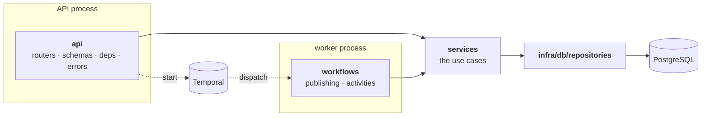
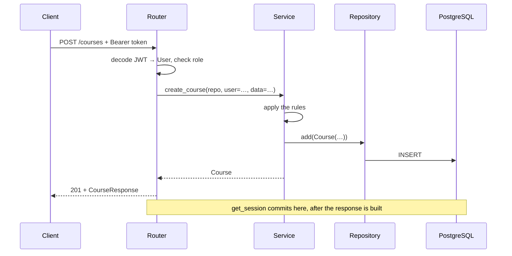
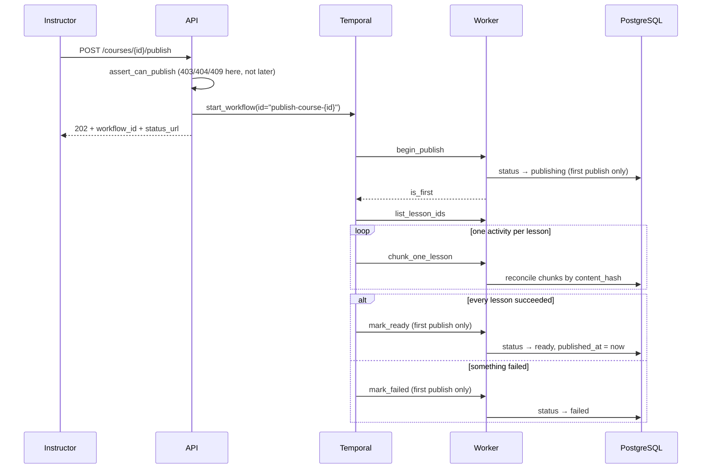

# SmartCourse — Technical Design

How the system is put together, how data and events move through it, and
which decisions were deliberate.

The README is the tour: what it is, how to run it, what the endpoints are.
This is the argument underneath — why the pieces are shaped this way and
what was rejected. Where a decision has a cost, the cost is stated.

Companions: **[SCHEMA.md](SCHEMA.md)** for every table and column,
**[API.md](API.md)** for endpoint design, **[PRD.md](PRD.md)** for the
numbered requirements referenced throughout (FR-nn).

---

## 1. Module breakdown

Two processes run. They share a codebase and a database and nothing else.



### `api/` — HTTP, and nothing else

| File | Holds |
|---|---|
| `routers/` | `auth`, `users`, `courses`, `enrollment` — paths, status codes, response shapes |
| `schemas/` | Pydantic request and response models |
| `deps.py` | Dependency wiring: the session, the current user, repositories, the Temporal client, `require_roles` |
| `errors.py` | One exception handler per domain error, so a service raising `ConflictError` becomes a 409 without knowing what a 409 is |

Routers answer exactly one permission question: **are you this kind of user
at all?** `dependencies=[InstructorOnly]` on the route. Anything requiring
knowledge of the row — *is this your course* — belongs a layer down.

That split was not free. Publishing originally skipped the route-level half,
so a student fell through to the ownership check and was told the course did
not exist — about a course they could read in the catalogue. The fix was to
apply the same two-part pattern as everything else.

### `services/` — one function per use case

The layer that would survive replacing FastAPI. No request object, no status
codes, no `temporalio` import.

| Module | Use cases |
|---|---|
| `auth.py` | register, authenticate, update profile, role self-assignment rules |
| `course.py` | the course/module/lesson tree, visibility, editability, content gating |
| `enrollment.py` | **admission** — enrol, withdraw, listings, prerequisites, capacity |
| `progress.py` | **studying** — marking lessons finished, and FR-15's course completion |
| `publishing.py` | publish permissions, status lifecycle, incremental chunking |
| `chunking.py` | pure text splitting — no database, no awaits |

**Both processes call this layer.** An HTTP request reaches `services` through
a router; a Temporal activity reaches the *same functions* directly. That is
the entire reason they know nothing about either, and it is what makes
publishing testable without a worker running.

### `domain/` — thin, deliberately

Only `errors.py`: `NotFoundError`, `PermissionDeniedError`, `ConflictError`,
`ValidationError`. The base class every layer can raise and only `api/`
knows how to translate.

**It is thinner than the layering implies**, and that is a tradeoff rather
than an oversight — see §4.

### `infra/` — everything that talks to the outside

| File | Holds |
|---|---|
| `db/models/` | SQLAlchemy models — the tables |
| `db/repositories/` | **Every query in the system.** `user`, `course`, `enrollment`, `chunk` |
| `db/session.py` | Engine, `SessionFactory`, and the request-scoped `get_session` |
| `security.py` | Argon2 hashing, JWT encode/decode |
| `temporal.py` | The lazily-connected, cached Temporal client |

If a `select()` appears outside `repositories/`, that is a bug. The point is
not purity: it is that when a query is slow, or a filter is wrong, there is
one place to look.

### `workflows/` — orchestration, and the work

| File | Holds |
|---|---|
| `publishing.py` | `PublishCourseWorkflow` — *what happens in what order*. No database access, no clock, no randomness |
| `activities.py` | Five activities, each a thin wrapper: open a session, call `services/publishing.py`, commit |

The division is forced by Temporal. A workflow is replayed from its recorded
history to rebuild its state, so it must take the same path every time.
Anything unpredictable — I/O, time, random — belongs in an activity, whose
result is recorded once and replayed unchanged afterwards.

### Entry points

`main.py` builds the FastAPI app. `worker.py` is the second process:
`uv run python -m smartcourse.worker`. `config.py` is pydantic-settings over
the environment. `seed.py` creates the first admin.

---

## 2. Data flow

### An HTTP request



**The transaction boundary is the request, not the service call.**
`get_session` yields one session, commits if the handler returned, rolls back
if it raised. So a request that fails halfway leaves nothing behind — an
enrolment is never recorded without its progress row — and services never
have to think about commits.

One consequence worth knowing: the commit happens *after* the response model
is built, so anything that marks a row dirty while serialising gets written.
That is a real bug this project hit — see `LessonResponse.without_content`
in §3.

### Who may read what

Three questions, answered in three places, in this order:

| Question | Where | Failure |
|---|---|---|
| Are you authenticated? | `deps.CurrentUser` | 401 |
| Are you this kind of user? | route `dependencies=[…]` | 403 |
| Does this row allow it? | the service | 404 or 403 |

The last one splits deliberately:

- **Cannot see it at all** (someone else's draft) → **404**, identical to a
  course that does not exist. Leaking existence through a permission error
  is still leaking.
- **Can see it, may not act on it** (a student publishing a published
  course) → **403**. A 404 here would contradict the catalogue screen they
  came from.

Reading *content* is a fourth question, separate from seeing the course at
all. `may_read_content` admits the owning instructor, an admin, or an active
enrolment — and the syllabus (titles and order) stays visible to everyone who
can see the course, because nobody enrols in a name.

---

## 3. Event flow: publishing

Publishing is the only asynchronous flow in the system so far. Part A §2
describes it as a multi-step background process; FR-13 requires that a
partial failure never leaves a course half-published.



### Why the endpoint writes nothing

Postgres and Temporal share no transaction. An endpoint that wrote the status
*and* started a workflow could do one and not the other:

- commit first, start fails → the course is stranded on `publishing` with
  nothing running
- start first, commit fails → a workflow runs against a course that still
  says `draft`

So the workflow owns **every** status write and the endpoint only starts it.
One writer, nothing half-done.

This does not remove the dual-write problem, it moves it: the endpoint still
returns 202 for a `start_workflow` that could in principle fail after
Temporal accepted it. The outbox pattern is the proper fix and is Module 3
work. Recorded, not pretended away.

### Idempotency

The workflow id is `publish-course-{course_id}`. Temporal refuses a second
workflow with a live id, so a double-click or a client retry **cannot** start
two publishes of the same course — not "is unlikely to". That is most of
FR-17 for this flow, obtained by choosing an id well rather than by writing
locking code.

The status check in `assert_can_publish` gives the readable 409. It is not
what holds under concurrency; two simultaneous requests would both pass it.

### Retries and compensation

Each lesson is its own activity. A failure retries that lesson alone — the
ones already done are in the history and never re-run. Cost: history size,
roughly 600 events for 200 lessons against a limit of 51,200.

`maximum_attempts=3`, not Temporal's default of forever. Chunking is
deterministic: a lesson that fails three times fails the fourth. Worse, a
workflow retrying for ever never reaches its `except`, so **infinite retries
would defeat FR-13** — the course would sit on `publishing` with nobody told.

Compensation sets the status and **deletes nothing**. The chunks written
before a failure are keyed by `content_hash`, so the next attempt reuses
them. Deleting would throw away exactly what FR-11a exists to preserve.

### Incremental republishing (FR-11a)

A republish hashes the new chunks and compares against what is stored:

```
same hash   keep the row, update its position if it moved
new hash    insert
hash gone   delete
```

Same row id means the row was never replaced — which in Module 4 means the
embedding was not thrown away and bought again. Editing one lesson in a
200-lesson course does not re-process the other 199.

### A republish does not move the status

A first publish and a republish are the same work on different objects.

| | First publish | Republish |
|---|---|---|
| Status while running | `publishing` | `ready` — unchanged |
| On success | `ready`, `published_at` set | unchanged |
| On failure | `failed` | unchanged |

`can_view` only lets `ready` through, so moving the status on a republish
would take a live course out of the catalogue for the length of a background
job — and leave it out permanently if the job then failed, since `failed` is
terminal.

And nothing readable changes during a republish. Lesson text is served from
`lessons.content`; chunks are derived data that nothing outside
`services/publishing.py` reads until the embeddings arrive in Module 4.
Search does not use them either — it reads the generated `search_vector`
columns, which Postgres maintains and publishing never touches.

The decision is made once, by `begin_publish`, and returned to the workflow.
It is held in a workflow local, which is safe **precisely because it came
from an activity**: the value is in the history and replays identically. A
workflow that read the status itself would see today's value on replay and
could take a different branch than the original run.

Cost: a failed republish is silent. `GET /courses/{id}/publish/status`
answers it on request; pushing it to the instructor needs `FailedEvent` and
is Module 3.

### Why the status endpoint returns two sources

Temporal is a workflow engine, not an archive. Histories age out of
retention, after which a long-finished publish is indistinguishable from one
that never happened — both report `state: "unknown"`. The course's own
`status` and `published_at` are durable but coarse: `ready` says *a* publish
succeeded, not that the *last* one did.

Returning both lets a caller separate "the last publish failed" from
"Temporal no longer remembers".

---

## 3a. Completion, and the two questions about an enrollment

Added in Module 3 (FR-14, FR-15). No new infrastructure — the
`lesson_progress` table was built in Module 1 and had never been written
to.

### A row is the fact

There is no `completed` boolean. One row in `lesson_progress` means "this
lesson was finished"; no row means it was not. Nothing stores a percentage
either — a stored figure is wrong the moment an instructor adds a lesson,
and nothing would recalculate it. "This person finished that lesson at
that time" stays true whatever changes around it.

The row points at the **enrollment**, not the student, which is what makes
re-enrolling work: a second attempt is a different enrollment, so it starts
fresh rather than inheriting the first attempt's progress.

### Completion is a subset test

```python
course_just_completed = bool(required) and required <= done
```

Every lesson belonging to the course must be among those finished.
`len(done) == len(required)` would be correct today and correct by
coincidence: two sets of equal size can hold different things. If a lesson
could ever leave a course while its progress row survived, counting would
report a course complete that was not. The subset version says what is
meant.

`bool(required)` guards the empty course — the empty set is a subset of
everything, so without it a course with no lessons would report itself
complete.

### The two questions, and why they are two methods

This is the part worth remembering, because the first version got it
wrong.

| Question | Method | Active | Completed | Withdrawn |
|---|---|---|---|---|
| May they take up a **seat**? | `get_active` | yes | no | no |
| May they read the **material**? | `get_for_content` | yes | **yes** | no |

They sound contradictory and are not. Capacity is how many people can
study *at once*, so a student who finishes releases their seat. Access is
about having earned the material, so they keep reading. Withdrawing fails
both — giving a course up is the opposite of finishing it.

**`may_read_content` asked `get_active` until FR-15 existed.** That was
harmless while nothing could reach `completed`, and it meant the first
version of this feature locked a student out of a course at the exact
moment they completed it. Every test of the enrolment gate in Module 2 had
run against the only status that occurred.

### A completed course stays completed

An instructor who adds a lesson to a course somebody has already finished
does not re-open it; the student is refused with 409 and the course stays
complete.

Re-opening would be wrong in two directions. It retracts an achievement
nobody asked to retract — and it reaches into a *different* course, because
FR-08 reads `completed` for prerequisites. Editing one course must not be
able to invalidate a student's enrollment in another.

### No undo

Completion is the student's own claim about their own learning rather than
a grade somebody awards, and a record that can be retracted is not much of
a record. The cost is a misclick with no recovery — which is exactly why
completing a course no longer removes access to it.

## 3b. Event flow: the outbox

Five business facts leave SmartCourse as Kafka messages. Getting them out
reliably is harder than it looks, because Postgres and Kafka share no
transaction.

### The problem

Saving an enrollment and publishing `student.enrolled` touch two systems.
Whichever goes second can fail on its own:

| Order | Failure | Result |
|---|---|---|
| commit, then send | the send fails | Ali is enrolled and nobody is told — and nothing records an event was owed |
| send, then commit | the commit fails | an event describing an enrollment that never happened |

Reordering does not help. There is no order in which two independent systems
both change or neither does.

### The fix

The event is written to a Postgres table, `outbox`, in the **same
transaction** as the business change. Both rows commit or neither does, and
there is no window between them because there is only one commit. A separate
dispatcher then reads unpublished rows and sends them to Kafka.

At the call site the whole pattern is one line:

```python
outbox.add(events.student_enrolled(...))
```

What this buys is not speed or decoupling — it is that **the set of events
sent always matches the set of things that happened.**

### What it does not buy

The dispatcher can send to Kafka and crash before marking the row published,
so a message may arrive twice. At-least-once is the guarantee. `event_id`
travels in every envelope so a consumer can recognise a repeat — that is
FR-17, and it is the consumer's job, not the outbox's.

### Lifetimes

A common misreading is that the outbox is where events are kept. It is the
shortest-lived copy of the three:

| | How long an event lives there |
|---|---|
| `outbox` | seconds — until the dispatcher sends it, then pruned |
| Kafka | 7 days (`KAFKA_LOG_RETENTION_HOURS: 168`) |
| an archive table | forever, if one is ever built |

The outbox is an out-tray, not a filing cabinet. It exists to survive the gap
between committing and sending, not to remember anything.

Rows are **marked** published rather than deleted, because `attempts` and
`published_at` are what answer "did we actually send that?" during an
incident. Keeping them costs the dispatcher nothing: `ix_outbox_unpublished`
is partial — `WHERE published_at IS NULL` — so a sent row drops straight out
of the index the dispatcher queries.

### The five events

| Topic | Key | Events |
|---|---|---|
| `smartcourse.users` | `user_id` | `user.registered` |
| `smartcourse.courses` | `course_id` | `course.published` |
| `smartcourse.enrollments` | `course_id` | `student.enrolled`, `student.withdrew`, `course.completed` |

One topic per **entity**, holding that entity's whole life story. Not one per
event type: Kafka guarantees order only within a topic-partition, so
splitting `student.enrolled` from `student.withdrew` would let a consumer see
a withdrawal before the enrollment it undoes. Not one topic for everything
either: users have nothing to do with enrollments, and a single stream would
make every consumer read and discard most of what it got.

The enrollment topic is keyed by `course_id`, not `enrollment_id`, because
the counters that break under reordering are the per-course ones.

### Thin events

Payloads carry ids, never copied data:

```json
{ "enrollment_id": "…", "student_id": "…", "course_id": "…" }
```

A stored course title would be wrong the moment the course was renamed, and
would split "most popular courses" into two rows for one course. Consumers
share this database and can look up whatever they need.

The one exception is `roles` on `user.registered`. Roles change (FR-03a), and
*"Ali registered as a student"* is a different fact from *"Ali is a student
today"*. Looking it up at read time would answer the second question, so a
replay after a promotion would quietly rewrite history.

### Where the events are written

| Event | Written in |
|---|---|
| `user.registered` | `register_user`, after the flush that assigns the id |
| `course.published` | `complete_publish` — reached only on a first publish |
| `student.enrolled` | `enroll`, after the flush |
| `student.withdrew` | `withdraw` |
| `course.completed` | `complete_lesson`, inside the FR-15 branch |

`course.completed` cannot fire twice: the moment that branch sets the status,
`_studying` starts raising 409 for that enrollment.

`complete_publish` runs inside a Temporal activity rather than a request, and
builds its `OutboxRepository` on the activity's own session. An activity is
retried after a crash, and a course left `ready` with no event sent would be
precisely the hole this pattern closes.

### Why `OutboxRepository` exists

It has one method that forwards to `session.add`. It earns its place by
keeping services away from the session: every service here takes repositories
and never sees an `AsyncSession`, which is what stops a service committing
halfway through a business rule.

`add` is not async and does not flush. The event must land in the same commit
as the business change, so the caller decides when that happens.

### Deviation from the plan

MODULE-3-PLAN.md lists `lesson.completed` as a sixth event. It is not built.
None of the nine statistics asks about a single lesson, and `lesson_progress`
rows already answer anything that might. An event nobody reads is retention
and schema surface spent on nothing.

## 3c. Event flow: the dispatcher

Section 3b put the event safely in Postgres. This section is the other half:
getting it out again, at least once always, without ever sending two events
for the same thing in the wrong order.

### One process, one instance

The dispatcher is its own service in `compose.yml`, `restart: unless-stopped`,
depending only on Postgres and Kafka. It does not share a process with the API
or the Temporal worker: it is a loop that should keep running when a request
handler crashes, and nothing it does belongs on the request path.

Exactly one instance, deliberately. Two would hold locks on different rows and
could publish two events for the same enrollment out of order - the one thing
the ordering rules below exist to prevent. The cost is a single point of
failure; the mitigation is that a crash loses nothing, because an unsent row
is still unsent.

### Three clocks, three jobs

Waking the dispatcher, retrying a failure, and sweeping for stragglers are
three different questions, and answering them with one number is how a polling
loop ends up either wasteful or slow.

| mechanism | job |
|---|---|
| `NOTIFY` on insert | send a new event immediately |
| a 5-minute ticker | catch a missed notification, and pick up rows that have become due |
| `next_attempt_at` on the row | how long a *failed* event waits before the next try |

Because they are separate, the ticker interval can change without changing
retry behaviour, and a retry delay can be tuned without making the loop busier.

An earlier draft polled every 500ms. Measured, that query costs 0.486ms - about
1.4 minutes of database time per day, which is affordable but pays for nothing:
it asks a question Postgres already knows how to volunteer.

### Why a trigger, and why a dedicated connection

The `NOTIFY` is raised by a Postgres trigger on `outbox`, not by application
code. Two reasons:

- services stay ignorant of Kafka and of the dispatcher. A service writes a
  row; what reads that row is not its concern.
- a notification raised inside a transaction is delivered **only on commit**.
  A rolled-back event can therefore never wake anything - the same guarantee
  the outbox itself relies on, obtained for free.

Several inserts in one transaction collapse into one notification, because the
payload is empty and Postgres de-duplicates identical notifications on a
channel. That is the right behaviour: the dispatcher runs the same query
whether it was woken once or ten times.

The listener needs a **raw asyncpg connection held open for the process's
lifetime**, separate from the SQLAlchemy pool. `LISTEN` is a property of a
connection; a pooled connection is handed back after each use and the
subscription dies with it. So the dispatcher holds two database paths: one
connection that does nothing but listen and set a wake flag, and the normal
pool for the work.

The notification carries no payload, not even the row id. The dispatcher runs
its query regardless, and a payload would be a trap: two rows inserted together
would need both ids, and the query already finds everything.

### One pass

```sql
SELECT * FROM outbox o
WHERE o.published_at    IS NULL
  AND o.abandoned_at    IS NULL
  AND o.next_attempt_at <= now()
  AND NOT EXISTS (
      SELECT 1 FROM outbox older
      WHERE older.published_at IS NULL
        AND older.abandoned_at IS NULL
        AND older.ordering_key = o.ordering_key
        AND older.created_at   < o.created_at
  )
ORDER BY o.created_at
LIMIT 100
FOR UPDATE SKIP LOCKED;
```

`FOR UPDATE` locks the rows it returns; `SKIP LOCKED` means another reader
steps over them instead of waiting. The lock lives and dies with the
transaction, so a dispatcher killed mid-send strands nothing - and that same
property is where at-least-once comes from, because a crash between "Kafka
accepted it" and "we recorded that" leaves the row to be sent again.

The lock is held for the whole pass, including the network call. Releasing it
first would buy nothing and risk a duplicate; the batch is bounded at 100 rows
and the send is bounded by `message.timeout.ms`.

All 100 messages are handed to the producer, then flushed once:

```python
for row in rows:
    producer.produce(row.topic, key=row.partition_key, value=row.payload)
producer.flush()
```

`produce()` only appends to librdkafka's internal queue and returns; `flush()`
is where the waiting happens. A batch of 100 therefore costs roughly one round
trip rather than 100. Results arrive as delivery reports, and the pass ends
with one `UPDATE` for the rows that succeeded and one for the rows that did
not.

A full batch means more is probably waiting, so the loop runs again
immediately. A partial batch means the backlog is drained, so it sleeps until a
notification or the next tick.

### Ordering: two keys, not one

`partition_key` and ordering are easily conflated. They answer different
questions, and using one for both is a bug.

| | question | value |
|---|---|---|
| `partition_key` | which Kafka partition, i.e. what *Kafka* keeps in order | `course_id` |
| `ordering_key` | what *this dispatcher* must not let overtake | `enrollment_id` |

The dispatcher needs its own notion because `next_attempt_at` breaks FIFO by
design - that is what a backoff is. Without a guard:

```
10:00:00  Ali enrols      -> E1 written, tried, Kafka hiccups, retry at 10:00:02
10:00:01  Ali withdraws   -> E2 written, due immediately
10:00:01  E2 sent         <- the withdrawal
10:00:02  E1 sent         <- the enrollment
```

A consumer sees a withdrawal for an enrollment it has never heard of, and a
seat count goes negative. The `NOT EXISTS` clause above is the fix: an event is
not sent while an older live event shares its `ordering_key`.

Using `partition_key` for the guard would block Sara's enrollment because Ali's
is stuck - two facts with no relationship to each other. The narrower key
blocks only what genuinely must not be reordered.

A useful consequence: because the guard excludes siblings, **a batch can never
contain two events with the same `ordering_key`**, so nothing inside a batch
can overtake anything else.

| event | `partition_key` | `ordering_key` |
|---|---|---|
| `user.registered` | `user_id` | `user_id` |
| `course.published` | `course_id` | `course_id` |
| `student.enrolled` | `course_id` | `enrollment_id` |
| `student.withdrew` | `course_id` | `enrollment_id` |
| `course.completed` | `course_id` | `enrollment_id` |

### Deciding what a failure means

The dispatcher must tell "try again later" from "this will never work", and it
must do so without knowing what Kafka is.

A `Publisher` protocol with a single method:

```python
class Publisher(Protocol):
    async def publish(
        self, events: Sequence[OutboxEvent]
    ) -> dict[UUID, DeliveryError | None]: ...
```

It takes a batch, because every transport worth using is batch-shaped -
`produce()` queues and returns, and the waiting happens once in `flush()`. It
reports per event rather than raising, because a batch has no single outcome
and an exception can only describe one. Anything actually raised from a
publisher is therefore a bug, not a delivery failure, and must be allowed to
crash rather than be mistaken for "Kafka is having a moment" and retried for a
day.

The two error types are the entire shared vocabulary:

| exception | meaning |
|---|---|
| `PermanentDeliveryError` | something about *this message* is wrong; retrying cannot help |
| `TransientDeliveryError` | something about the *world* is wrong; retrying can help |

The wrapper translates. `KafkaPublisher` is the only file in the codebase that
imports `confluent_kafka`, and it holds a deliberately short list of codes that
are permanent - `MSG_SIZE_TOO_LARGE`, `INVALID_MSG`, `RECORD_LIST_TOO_LARGE`,
`_VALUE_SERIALIZATION` and its `_KEY_SERIALIZATION` twin. **Everything else,
including anything unrecognised, is transient.**

That default is the whole design, and it is chosen by asking which mistake
hurts more:

| mistake | cost |
|---|---|
| called transient, actually permanent | retries, eventually abandoned. Late, but correct |
| called permanent, actually transient | a real event is thrown away. Data loss |

So the list grows only when something is proven permanent. A misconfigured ACL,
for instance, stays transient: it retries, the one-hour warning fires, a human
fixes the ACL, and the backlog drains. Marking it permanent would have killed
every event raised during the outage.

An earlier draft tried to classify with `KafkaError.retriable()`. Verified
before building on it: that flag is attached by librdkafka to real errors and
reads `False` for an error constructed from a code, including
`_ALL_BROKERS_DOWN`. It cannot be relied on, and the approach was dropped.

### Backoff, and why one success resets everything

A transient failure increments `attempts`, stamps `last_attempt_at`, and
schedules the next try:

```python
delay = min(2 ** attempts, backoff_cap_seconds(event.event_type))
next_attempt_at = now() + delay
```

Doubling, then capped. The cap is what decides recovery time: whatever it is,
the system notices a recovered service within that long.

The caps live in one table in `events.py`, next to the event-type constants:

```python
DEFAULT_BACKOFF_CAP_SECONDS = 1800        # 30 minutes

BACKOFF_CAP_SECONDS = {
    COURSE_PUBLISHED: 60,
    STUDENT_ENROLLED: 300,
    COURSE_COMPLETED: 300,
}
```

Looked up at send time rather than stored on the row. `topic` *is* stored,
because routing is a fact about the event decided when it is created; a backoff
cap is a tuning knob, and a knob stamped into 4,000 waiting rows cannot be
turned during the incident it matters in. An event type missing from the table
gets the default, so adding an event requires remembering nothing.

The schedule itself is on the row rather than in the dispatcher's memory, and
that is the part that matters: a restart, a deploy or a crash does not reset
anyone's backoff, and the schedule is visible in `psql`.

**One success resets the whole backlog.** After any successful send:

```sql
UPDATE outbox SET next_attempt_at = now()
WHERE published_at IS NULL AND abandoned_at IS NULL AND next_attempt_at > now();
```

A success proves the service is up, which makes every waiting row's schedule
stale information. Without this, a two-hour outage would end with each event
serving out its own thirty minutes. With it, the first event whose timer
expires acts as a probe for all of them and the backlog drains together.

This is also what the shorter cap on `course.published` is really for. Not
because the event is urgent - the course is `ready` in Postgres and fully
enrollable before Kafka hears anything, so what is delayed is a statistic and a
notification, not a student. Its job is to knock on Kafka's door every minute
so the reset fires early for everyone else.

### Giving up

Two things abandon an event, and both write a `FailedEvent` row and set
`abandoned_at`:

- a `PermanentDeliveryError`, immediately
- surviving 24 hours unsent, found by a sweeper on each tick

`attempts` gates nothing. It is a counter for diagnosis, and an earlier draft
that used it as the give-up signal had a bug worth recording: because the
delays double, ten attempts elapse in about seventeen minutes, so a
twenty-minute outage would have abandoned the entire backlog while claiming a
24-hour policy. A separate `abandoned_at` column keeps "how many times did we
try" and "did we decide to stop" as the two different facts they are.

Every query then reads the same sentence - `published_at IS NULL AND
abandoned_at IS NULL` - and a replay is `UPDATE outbox SET published_at = NULL,
abandoned_at = NULL, attempts = 0`.

A third sweeper, also per tick, logs a warning for anything unsent for over an
hour. It is a log line and nothing more until Area F adds a Prometheus gauge
and a Grafana alert; recorded here so the gap is deliberate rather than
discovered.

### Producer settings

```
enable.idempotence = true
acks               = all
message.timeout.ms = 30000
```

`enable.idempotence` matters more than it looks: without it, librdkafka's own
internal retries can reorder messages within a partition, which would quietly
undo the ordering guard above. `acks=all` means every in-sync replica has the
message before we write `published_at`, so that column records a real promise
rather than a hopeful one.

On SIGTERM - a redeploy, or `docker compose down` - the dispatcher finishes the
batch in flight and exits. Being killed mid-batch is survivable, since the
transaction rolls back and the rows are simply still unsent, but finishing
cleanly avoids a pointless round of duplicates.

### What this does not solve

Four holes, accepted rather than missed:

- **An abandoned event releases its key.** If `student.enrolled` is abandoned,
  the matching `student.withdrew` is no longer blocked and reaches consumers as
  an orphan. Holding it forever is worse: the key would jam permanently and a
  true fact would be lost as well. Consumers already have to tolerate
  duplicates under at-least-once; tolerating an orphan is the same discipline.
- **Re-enrolling starts a new ordering key.** A withdrawal from an old
  enrollment and an enrollment into a new one can therefore reorder. Harmless
  here: popularity is a plus-one minus-one total, and completion rate pairs by
  `enrollment_id`.
- **The guard cannot see uncommitted rows.** Two overlapping transactions
  writing to the same key could let the later one through first. It does not
  bite us, because our five events are causally ordered through the database -
  you cannot withdraw from an enrollment that is not yet committed and visible.
- **Nobody is paged.** The one-hour warning is a log line until Area F.

Pruning published rows is deferred to Area C with Celery beat. Avro and a
Schema Registry are deferred within Area B. A `destination` column and a
`topic`-to-`route` rename, for the day a second transport exists, stay cheap
precisely because outbox rows are transient - the table is seconds deep, so
there is no history to migrate.

## 4. Key design decisions

Each row is a decision that could reasonably have gone the other way.

### Structure

| Decision | Rejected | Why |
|---|---|---|
| Two processes, API and worker | One process running both | They scale and fail differently. Chunking a 200-lesson course should not compete for the event loop serving logins, and a worker crash should not take the API down |
| Services know nothing about HTTP or Temporal | Logic in routers, or in activities | It is what lets the same function be called by a request and by an activity. Activities are five thin wrappers because of it |
| Every query in `repositories/` | Queries wherever convenient | When a query is wrong or slow there is one place to look |
| Permission split across route and service | All of it in one place | A route can ask "are you an instructor"; only the service can ask "is this yours". Collapsing them produced the publish-404 bug |

### Concurrency and consistency

| Decision | Rejected | Why |
|---|---|---|
| Capacity checked under `SELECT … FOR UPDATE` on the course row | Counting, then inserting | Check-then-act. Two simultaneous requests for the last seat both count *n-1* and both insert. The lock serialises them. `session.get()` would not do — the identity map can satisfy it without SQL, and a lock that issues no SQL is not a lock |
| One active enrolment per course: a **partial unique index** | A service-level check | A uniqueness rule enforced in Python is enforced until two requests arrive together. Partial, so withdrawing and re-enrolling stays possible |
| Workflow id as the idempotency key | A status check | See §3 |
| Chunk positions: `DEFERRABLE INITIALLY DEFERRED` unique constraint | Delete-then-insert | Republishing an edited lesson shuffles positions, which transiently duplicates one. Deferring the check to commit lets the final state be valid without ordering the writes by hand |

### Data

| Decision | Rejected | Why |
|---|---|---|
| Generated `tsvector` columns with GIN indexes | `LIKE '%term%'` | LIKE does not match "recursion" for "recursive", reads every row, and cannot rank. Generated rather than trigger-maintained so it cannot drift |
| `enrolled_count` as a `column_property` subquery | Counting per course in the service | One round trip for a listing of twenty, not twenty counts |
| Active enrolments only; completing frees a seat | Counting completed against capacity | A course with capacity 2 whose two students finish would be permanently full. Capacity is how many can study *at once* |
| `content_locked` as an explicit field | Letting clients infer it from null content | Null is ambiguous — an unwritten lesson looks exactly like a withheld one, and the inference breaks the first time an instructor saves an empty lesson |
| Chunks carry `content_hash` | Comparing text | It is what makes a republish incremental, and it is a cheap column |
| Completion is a row, and the percentage is counted | A `completed` flag and a stored percentage | A stored figure is wrong the moment a lesson is added, and nothing recalculates it |
| `POST /lessons/{id}/completion` | `/complete`; `PATCH /lessons/{id}/status` | A noun says what is created. `status` would read as a property of the lesson — and lessons are a plausible future owner of a real status — when this is a fact about the caller |
| 200 on completion, not 201 | 201, or alternating 201/200 | The second identical request creates nothing. 201 would be a lie, and alternating makes clients branch on what `newly_completed` already says |

### A bug worth recording

`LessonResponse.without_content` builds the response field by field rather
than loading the model and clearing the attribute. The lesson is attached to
the session, so assigning to it would mark the row dirty — and `get_session`
commits after the response is built, so hiding the content would have
**UPDATEd the lesson to empty**. Erasing data in order to withhold it, and it
would have passed every test that only reads responses.

---

## 5. Assumptions and tradeoffs

### Assumptions filling gaps in the brief

| Assumption | Basis |
|---|---|
| Chunking belongs in Module 2, not Module 4 | Part A §2 lists chunks as a publishing output; Guidelines §6 Week 4 says "content chunking (from Part A)". The readings conflict. Proceeding on Part A's, because the Temporal workflow needs something to orchestrate. **Worth confirming at review** |
| Republishing is in scope | Part A §2: "when an instructor publishes *or updates* a course"; §1: instructors "publish updates" |
| An instructor may enrol in their own course | No rule against it and no harm found. They can read the content anyway |
| A withdrawn enrolment grants nothing | Keeping the material after leaving would make withdrawing free |
| 400 tokens per chunk, 60 overlap | No figure in the brief. Configurable; revisit when embeddings exist and the ceiling is a real model's |

### Known limitations

| Limitation | Why it stands |
|---|---|
| **No outbox.** `POST /publish` writes nothing, but `start_workflow` succeeding and the response being lost are still two facts in two systems | The general fix is Module 3's event work. The endpoint's current shape makes the window as small as it can be without one |
| **A failed republish tells nobody.** The instructor has to ask the status endpoint | Pushing it needs `FailedEvent` — modelled, unused, and Module 3 (Guidelines §5 Week 3, "Events & Observability") |
| ~~**`completed` is unreachable**~~ — closed by FR-14/15 | `POST /lessons/{id}/completion` reaches it. Two rules that had never run now do: completing frees a seat, and FR-08's "completed, not merely started" prerequisite can finally be satisfied |
| **Token counts are estimates** — `words × 1.3`, not a tokenizer | No model is chosen yet. Swapping in a real tokenizer changes one function, and every size check already measures the joined string rather than summing estimates |
| **Uploads and extraction are not built.** `Asset` exists; nothing writes it | Cut from Module 2 deliberately — the PRD over-scoped it relative to the Guidelines' Week 2 |
| **`domain/` holds only errors.** Entities are SQLAlchemy models in `infra/db/models/` | Honest tradeoff. Separate domain entities would mean mapping every row twice for a system whose rules are mostly about rows. The cost is that `services` import from `infra`, so the dependency arrow is not as clean as the diagram suggests. Revisit if the rules outgrow the tables |
| **Temporal's address is a module constant**, not a setting | Two places need it and both are local. It moves into `Settings` the moment anything runs elsewhere |
| **Single Temporal namespace, dev server** | Nothing here needs more. A production deployment would need namespaces, retention policy, and archival decided |

### What the tests do and do not prove

| Layer | Real | Faked |
|---|---|---|
| `test_publishing.py` | services, database | Temporal entirely |
| `test_publish_workflow.py` | workflow, Temporal server | the activities |
| `test_publish_endpoint.py` | endpoint, database | the Temporal client |
| `test_publish_end_to_end.py` | **all of it** | nothing |

`test_progress.py` covers FR-14/15 through the API. Three of its tests exercise rules that had never run before completion existed: a freed seat, a satisfied prerequisite, and the content gate holding open for a student who has finished.

The first three each test one half against a fake of the other, which is the
right shape for each — and together they still left a gap: nothing checked
that the pieces fit. `test_publish_end_to_end.py` runs a real worker with the
real activities against a real database and a real Temporal, publishes,
edits a lesson, republishes, and asserts the untouched lessons keep their
chunk row ids.
